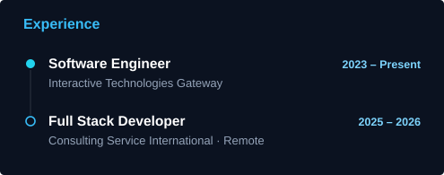

<div align="center">

<a href="https://hammad-ali-dev.vercel.app"></a>

<br /><br />

<a href="https://hammad-ali-dev.vercel.app"></a>
<a href="https://linkedin.com/in/hammad-ali-1a4631255"></a>
<a href="mailto:ch.hammad2914@gmail.com"></a>
<a href="https://hammad-ali-dev.vercel.app/resume/Hammad_Ali_Resume.pdf"></a>

</div>

<br />

## 👋 About me

I'm a Full Stack Software Engineer from Karachi with 3+ years of building enterprise ERP systems, SaaS products and AI-powered business applications: from data models and APIs to the React screens people use every day.

```ts
const hammad = {
  role: "Full Stack Software Engineer",
  location: "Karachi, Pakistan",
  experience: "3+ years",
  frontend: ["React", "Next.js", "TypeScript", "React Native", "Tailwind CSS"],
  backend: ["Node.js", "NestJS", "Express", ".NET Core Web API", "Prisma"],
  databases: ["PostgreSQL", "SQL Server", "MongoDB", "Redis"],
  ai: ["OpenAI API", "Gemini", "Document extraction", "Agentic AI"],
};
```

<br />

## 🛠️ Tech stack

<div align="center">


<br />


</div>

<br />

## 🚀 Featured work

<table>
<tr>
<td width="50%" valign="top">

### 🧠 Cortex
**AI-powered enterprise ERP**

8 connected modules for 100+ users across 7+ roles. An OpenAI pipeline reads 8–12 document formats with human review, cutting processing time by ~70%. AG Grid screens handle 50,000+ rows live.

`React` `NestJS` `PostgreSQL` `OpenAI` `AG Grid`

<sub>🔒 Built at ITG · private repo</sub>

</td>
<td width="50%" valign="top">

### 🏫 Okulium
**Multi-tenant school management SaaS**

9 modules from attendance to fees, school groups with branch-level data, audit trails for corrections, and an installable PWA.

`React` `Vite` `NestJS` `Prisma` `PostgreSQL`

<sub>🌐 [okulium.pk](https://okulium.pk)</sub>

</td>
</tr>
<tr>
<td width="50%" valign="top">

### 🧾 Vendor Portal
**Supplier invoicing automation**

10,000+ supplier documents a year, extracted and checked by a person, then turned into logistics invoices and debit notes. ~70% less manual work.

`React` `.NET Core` `SQL Server`

<sub>🔒 Built at ITG · private repo</sub>

</td>
<td width="50%" valign="top">

### ⚖️ Law in Action
**Global regulations platform**

A live subscription product that shows businesses which regulations apply to them, with HS-code classification over a 10,300-entry dataset and a metered API for clients' own systems.

`React` `Express` `Prisma` `PostgreSQL`

<sub>🌐 [lawintoaction.com](https://lawintoaction.com) · built at CSI</sub>

</td>
</tr>
</table>

<sub>Also at ITG: **Integra**, a quality inspection platform with 7 approval workflows for 50+ inspectors, live dashboards and automatic PDF reports.</sub>

<br />

## 📊 Activity & experience

<div align="center">




</div>

<br />

## 🌱 Currently learning

**Agentic AI & FDE Program** · Saylani Mass IT Training (SMIT) · Aug 2026 – Jul 2027

A year-long program in agentic AI and Forward Deployed Engineering (FDE): building AI agents and putting them to work inside real businesses.

<br />

<div align="center">

<picture>
  <source media="(prefers-color-scheme: dark)" srcset="https://raw.githubusercontent.com/hammad2914/hammad2914/output/github-snake-dark.svg" />
  <source media="(prefers-color-scheme: light)" srcset="https://raw.githubusercontent.com/hammad2914/hammad2914/output/github-snake.svg" />
  
</picture>

</div>


